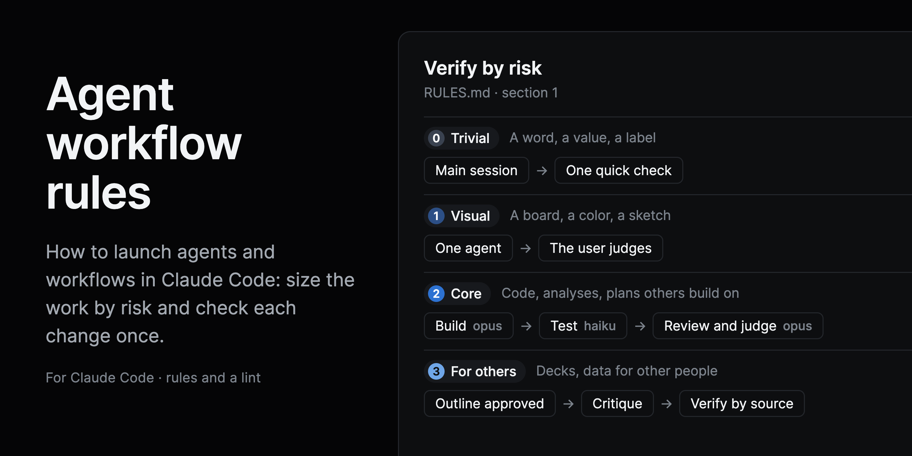
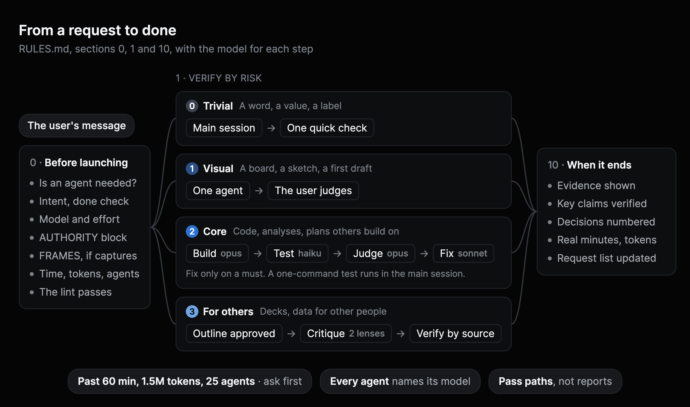

<p align="center">
  
</p>

<h1 align="center">Agent workflow rules</h1>

<p align="center">
  How to launch agents and workflows in Claude Code:<br>
  size the work by risk, pick a model per step, check once, and spend tokens on purpose.
</p>

<p align="center">
  
  
  
</p>

<p align="center">
  <a href="RULES.md"><b>The rules</b></a> ·
  <a href="#getting-started"><b>Getting started</b></a> ·
  <a href="#the-lint"><b>The lint</b></a> ·
  <a href="CHANGELOG.md"><b>Changelog</b></a>
</p>

## Overview

A Claude Code session that can launch subagents and workflows tends to overbuild. Every change gets a judge, every fix gets another review, a fan-out inherits the session's model and runs everything on Opus, and nobody knows how long the run will take or how many tokens it will burn.

This guide makes the main session size the work before it launches anything, and verify each change according to its risk. It is one Markdown file, [`RULES.md`](RULES.md), plus a workflow template and a lint that checks a workflow script before it launches.

**What it does differently:**

- **Verification follows risk.** A trivial edit gets one quick check. A visual change or a first draft goes to the user, who judges it. Only work that other work builds on gets a judge, whether it is code, an analysis or a plan, and only work for other people gets verification by source.
- **Each step gets the model it needs.** Haiku runs the mechanical checks, Sonnet reads and fixes, and Opus builds and judges. Nothing inherits the session's model by accident.
- **Review and judge are one step.** One Opus agent per run reads the test results and the evidence and tries to prove the work is not done. A fix runs only if it finds a must, and the main session checks the fix from its diff and check result.
- **Every run has a size.** Each workflow declares its level, minutes, tokens and agents, and a part over 60 minutes, 1.5 million tokens or 25 agents needs the user's permission before it launches.
- **The user's words travel with the task.** Every prompt carries the user's latest message, verbatim, so a relayed message never derails an approved task.
- **"Done" means evidence:** a capture, a test result or, for analysis, the sources behind each claim. Not "planned" or "noted".

## The rules

<p align="center">
  
</p>

| Section | What it covers |
|---|---|
| [0. Before launching](RULES.md#0-before-launching-seven-checks) | Seven checks before any agent starts |
| [1. Verify by risk](RULES.md#1-verify-by-risk) | Four levels, from a trivial edit to work for others |
| [2. Which shape to use](RULES.md#2-which-shape-to-use-by-task) | Task types mapped to a level and a shape |
| [3. Model and effort](RULES.md#3-model-and-effort-per-step) | Haiku, Sonnet and Opus, and effort per step |
| [4. The archetype workflow](RULES.md#4-the-archetype-workflow-level-2) | Build, test, review and judge, fix only if needed |
| [5. The deliverables flow](RULES.md#5-the-deliverables-flow-level-3) | Outline approval, two-lens critique, verification by source |
| [6. What every prompt carries](RULES.md#6-what-every-prompt-carries) | AUTHORITY, FRAMES, RULES, TASK and a schema |
| [7. Spend tokens on purpose](RULES.md#7-spend-tokens-on-purpose) | Paths instead of reports, few commands per agent, a lean `CLAUDE.md`, tokens per model |
| [8. Checks](RULES.md#8-checks) | Targeted checks run once, charts seen drawn, codes shown with their names |
| [9. Mechanical check and operation](RULES.md#9-mechanical-check-and-operation) | The lint, naming, and how to stop or change a running workflow |
| [10. When it ends](RULES.md#10-when-it-ends) | Verify key claims, evidence, numbered decisions, real figures |
| [Request tracking](RULES.md#request-tracking) | One living request list, an owner for every request, short rounds |
| [Template](templates/level-2-archetype.js) | The level-2 archetype, a workflow script ready to copy |

## Getting started

1. **Copy three files into your project, unchanged, to these paths** (an agent does this for you, see below):

   | From this repository | To your project |
   |---|---|
   | `RULES.md` | `docs/agent-workflow-rules.md` |
   | `tools/workflow-lint.mjs` | `tools/workflow-lint.mjs` |
   | `templates/level-2-archetype.js` | `tools/workflow-templates/level-2-archetype.js` |

   Then add an "Agents and workflows" section to your `CLAUDE.md` (Appendix A of the rules, for your project) with a line that tells the main session to read `docs/agent-workflow-rules.md` before launching agents or a workflow, and a line with the seven checks. Do not import the rules with `@`: an import loads them into every call of every agent, and only the main session needs them.
2. **Fill in [Appendix A](RULES.md#appendix-a-your-projects-specifics)** with your project's request list, build lock, test suite and dev server.
3. **For each workflow,** start from your copy, `tools/workflow-templates/level-2-archetype.js` (the original is [`templates/level-2-archetype.js`](templates/level-2-archetype.js) in this repository), fill in every `…`, run the lint, and show the phase table before launching.

### AI assistants

To have a Claude Code agent install the rules in the project it works in, give it this line:

> Install the agent workflow rules from https://github.com/creative-context/agent-workflow-rules in this project. Follow its SETUP.md.

[`SETUP.md`](SETUP.md) tells the agent where to copy each file, how to fill in Appendix A from the project, what to ask before changing anything, and what to report.

To work on this repository itself, an agent reads [`AGENTS.md`](AGENTS.md), which `CLAUDE.md` imports.

## The lint

`tools/workflow-lint.mjs` checks a workflow script before it launches, and runs with `bun` or `node`:

```bash
bun tools/workflow-lint.mjs templates/level-2-archetype.js
```

It fails when the script has no agent call, `meta.description`, `meta.level`, `meta.estimate`, `meta.tokens` or `meta.agents` is missing, `meta.agents` is fewer than the agent calls, a level does not fit its limits (level 1 is one agent with no review, and levels 2 and 3 need a review, judge or verify step, except part A of a split run, which declares `part: 'A'` in `meta`), an agent has no explicit model or effort, a label is not `role:item · effort` with a role from the list in section 9, a prompt has no AUTHORITY block, a part runs over 60 minutes, 1.5 million tokens or 25 agents without the user's dated permission in `meta.overrun`, a prompt mentions captures without `FRAMES:`, a prompt asks for the full suite, or a prompt pastes a whole report. Three flags allow the exceptions the rules allow: `--allow-fable`, `--allow-full-suite` and `--allow-inline-report`. Each one needs `meta.override` with the reason and the date.

## License

[CC BY 4.0](LICENSE). Share and adapt it, commercially too, with credit and a link to this repository.
